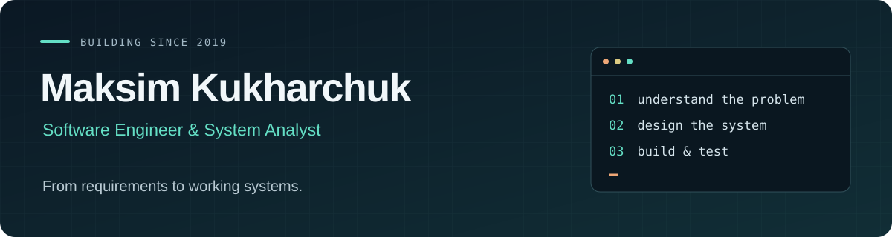

  

  <a href="https://gitlab.com/maksimkh34"><b>GitLab ↗</b></a>
  &nbsp; · &nbsp;
  <a href="https://t.me/maksimk34">Telegram</a>
  &nbsp; · &nbsp;
  <a href="mailto:me@redkernel.studio">Email</a>
  &nbsp; · &nbsp;
  Minsk, Belarus

I build software that connects people, devices, and infrastructure. My work spans **C#/.NET desktop applications, Python services, hardware integration, and system analysis** — from understanding the problem and designing interfaces to implementation and integration testing.

Programming since **2019**. Studying **Mechanics & Mathematical Modeling at Belarusian State University**. Most of my recent public work lives on **[GitLab](https://gitlab.com/maksimkh34)**.

## What I'm working on

- **Retail engineering at Santa Retail** — developing a prototype for weighing and label-printing workflows, integrating Massa-K scales via protocols 2/100. The work covers requirements, architecture, a WPF application, and an **ATmega2560 scale emulator** for integration testing.
- **RedKernel Studio / Academy** — leading a **7-developer student team** and a learning community of around **20 people**, with peer-learning tracks in ML and embedded development.
- **Android & Linux tooling** — exploring device servicing, kernel builds, and reproducible Docker environments on Android hardware.

## Selected projects

| Project | What I built | Stack |
| :--- | :--- | :--- |
| **[Universal Device Manager](https://github.com/maksimkh34/UniversalDeviceManager)** | Android servicing and firmware automation, with desktop frontends and a custom **DIL scripting language** for device workflows. | C# · .NET · WPF · Avalonia · ADB/Fastboot |
| **[KryptoBot](https://github.com/maksimkh34/KryptoBot)** | A Telegram service for TRON payments, covering wallets, orders, transfers, and payment receipts. | Python · Telegram API · TRON |
| **[XMessenger](https://github.com/maksimkh34/XMessenger)** | A network messenger prototype with desktop clients, a Java server, authentication, and HMAC-based message protection. | C# · WPF · Avalonia · Java |
| **[Docker on Android](https://gitlab.com/maksimkh34/android-docker-mi11t)** | Reproducible Docker and KernelSU-Next integration for the Xiaomi Mi 11T, including kernel configuration, build checkpoints, and operational guides. | Linux · Docker · Android · KernelSU |

## Engineering toolkit

**Core** &nbsp; C# / .NET · Python · WPF · Avalonia · SQL · SQLite · EF Core · REST APIs

**Systems & delivery** &nbsp; Linux · Git · Docker / Compose · GitLab CI/CD · ADB / Fastboot · Arduino / ATmega

**Analysis & design** &nbsp; Requirements · Architecture · BPMN / DMN · OpenAPI · ERD · Technical documentation

**Also in my workflow** &nbsp; C++ · Java · AI-assisted development · LLM agents · MCP

## Beyond the code

- Completed the **T-Bank / T-Academy System Analysis program** in 2026.
- Received a **1st-degree diploma at РобИн-2024**, a national-level programming competition.
- Led the team behind **Velora**, a hackathon IaaS project for VM provisioning and lifecycle management using libvirt and cloud-init.
- Interested in **mathematical modeling, embedded systems, audio electronics, and DSP**.

---

**Have a project involving desktop software, device integration, or system design?** [Let's talk.](mailto:me@redkernel.studio)
